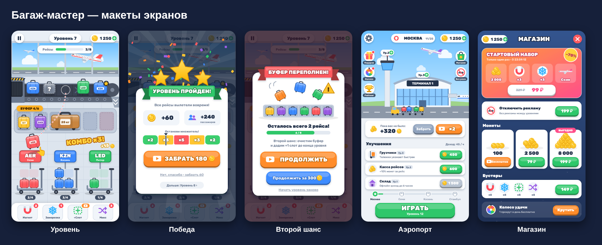

# Багаж-мастер (Baggage Rush)

2D-головоломка про сортировку багажа в аэропорту. Unity 6, первая площадка — **Яндекс Игры** (WebGL), затем RuStore и Google Play.



- Дизайн игры, монетизация и план работ — [docs/PLAN.md](docs/PLAN.md)
- Макеты экранов — [docs/mockups](docs/mockups)

## Структура

```
Assets/_Game/
  Scripts/
    Core/          запуск игры, сервисы, сохранения, пауза
    Platform/      интерфейсы площадок и их реализации (сейчас — заглушки для редактора)
    Monetization/  правила показа рекламы, товары и что за них выдаётся
    Debug/         временная отладочная панель
  Editor/          меню YAGAMES: настройка проекта и сборка сцен
  Fonts/           Rubik (кириллица, латиница, турецкий), лицензия OFL
docs/              план и макеты
tools/             служебные скрипты (проверка компиляции, генерация .meta)
```

## Первая настройка (один раз)

Нужны Unity Hub с последней Unity 6 (модуль **Web Build Support**) и Git.

1. В Unity Hub: **New project → Universal 2D**, имя `YAGAMES`, папка, например, `C:\Projects`. Дождитесь открытия редактора и **закройте Unity**.
2. В папке `C:\Projects\YAGAMES` откройте терминал (Git Bash или PowerShell) и выполните:
   ```bash
   git init
   git remote add origin https://github.com/DemiurgeBMR/YAGAMES.git
   git pull origin main
   git branch -M main
   git add -A
   git commit -m "Проект Unity 6 (шаблон Universal 2D)"
   git push -u origin main
   ```
3. Откройте проект в Unity. В верхнем меню появится **YAGAMES**:
   - **1. Настроить проект под WebGL** — сжатие Brotli, размер 540×960, стриппинг, символ `YANDEX_GAMES`;
   - **2. Собрать сцену Main** — создаёт сцену и добавляет её в сборку.
4. Нажмите **Play**. Должна появиться отладочная панель: кнопки рекламы, покупки и прохождения уровня работают, после перезапуска Play Mode монеты сохраняются.
5. Закоммитьте и запушьте изменения, которые появились после шагов 3–4 (настройки, сцена, .meta).

## Как работаем

1. Claude пишет код и графику в отдельной ветке и открывает Pull Request.
2. Вы вливаете PR на GitHub (**Merge**) и делаете `git pull` в папке проекта.
3. Проверяете в Unity и пишете, что не так: текст ошибки из Console или скриншот.

Всё, что меняете в Unity сами (настройки, сцены), коммитьте и пушьте, чтобы Claude видел актуальную версию.
